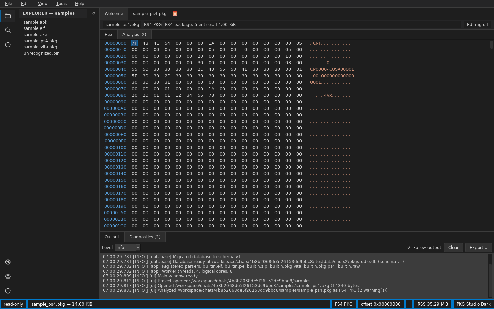
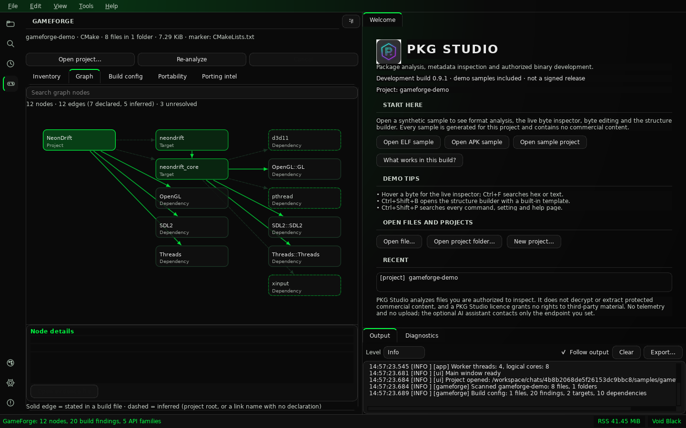
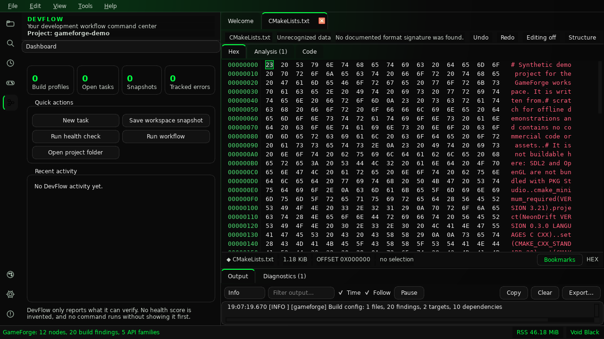
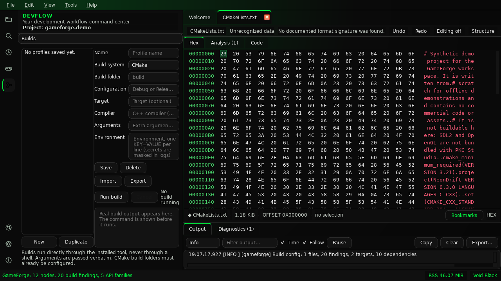

# PKG Studio

A lightweight, native desktop IDE for package analysis, metadata inspection and authorized
binary development. Proprietary software: see [LICENSE](LICENSE), [TERMS.md](TERMS.md) and
[PRIVACY.md](PRIVACY.md). Built with C++20, Qt 6 Widgets and CMake — no Electron, no bundled web
runtime.



**Version 0.7.0 (development build).** This repository contains a real, running application: the
VS Code-style shell with the Void Black design system, the SQLite data layer, the format
analysis core with signature confidence, and a hex workspace with a live byte inspector,
signature overlay, same-length replace, opt-in editing, undo/redo and backup-on-save. It also
has readable byte listings that assemble back into the file, image themes, and an optional AI
assistant that talks to a local OpenAI-compatible endpoint and proposes byte edits. A CPU
disassembler, a debugger, a plugin runtime and code-signed installers are *not* present; see
[docs/ROADMAP.md](docs/ROADMAP.md) for the honest status of every phase, and
[docs/CODE-LISTING.md](docs/CODE-LISTING.md) for what the Code tab does and does not do.

## What works today

**Shell and workspace**
- Activity bar with Explorer, project Search, Recent, GameForge, DevFlow and Help sections,
  plus a resizable explorer tree backed by `QFileSystemModel`.
- Editor area with multiple tabs, per-file header strip (`read-only`, format, summary).
- Bottom output console with a live log: level and text filters, optional timestamps, pause
  control, copy, confirmed clear, export, jump-to-source on double-click, and credential
  redaction before anything is displayed.
- Welcome page with open-file / open-project / new-project / recent actions.
- Status bar: mode, file, format, cursor offset, selection length, busy indicator, resident
  memory and current theme.
- Command palette (`Ctrl+Shift+P`) generated from the real command registry.
- Drag and drop of files and folders, session restore, recent files/projects.

**GameForge (game projects)**
- `Ctrl+Shift+G` opens the GameForge workspace for a local game project folder: a bounded,
  cancellable background scan (no symbolic links, no writes to the project) detects CMake,
  Meson, Makefile, Godot, Unity and Unreal projects from marker files and shows a
  categorised folder tree with per-file sizes, a name/folder/category filter and
  open-in-hex-editor.
- *Analyze portability* reads source-like files and reports known API families (Win32,
  Direct3D, Metal, OpenGL, Vulkan, SDL, GLFW, XInput, XAudio2, CoreAudio, OpenAL,
  FMOD/Wwise, pthread, std::thread) with match counts and a `file:line` example. The report
  states its own limits: it is textual evidence for a port, not an automatic port, a build
  result or a verdict.
- **Build configuration inspector**: parses CMake, Meson, Makefiles, `project.godot` and
  Unreal `*.uproject` files into targets, versions, compiler settings, architecture flags
  and platform conditions. Every row keeps the source `file:line` and opens it on
  double-click; unparsable files become warnings instead of guesses.
- **Dependency graph**: zoomable, pannable layered canvas with node search, selection and a
  details panel. Solid edges are stated in a build file, dashed edges are inferred (the
  project root, link names without a declaration). Target cycles are reported as paths and
  undeclared link names are listed as unresolved; node and edge limits are shown, never
  silently applied.
- **Porting intelligence**: Windows, Linux/POSIX, architecture, graphics/input and external
  dependency sections with recommendations derived only from the parsed build files and the
  API scan, each citing its evidence; absent evidence is reported as absent.

The bundled `samples/gameforge-demo` project exercises all of the above: two CMake targets,
a declared SDL2/OpenGL dependency, undeclared link names (`d3d11`, `xinput`, `pthread`), platform
conditions and Win32/D3D source. It is synthetic and is not buildable without SDL2 installed;
see [its README](samples/gameforge-demo/README.md).



**DevFlow (development command center)**
- `Ctrl+Shift+D` opens DevFlow: a dashboard with the current project, activity, saved build
  profiles, open tasks, tracked errors, snapshots and quick actions.
- **Build profiles**: name, build system, build folder, configuration, target, compiler,
  extra arguments and environment entries, saved to SQLite and importable/exportable as JSON.
  Only CMake, Meson and Makefile are offered, and only when the tool is installed. **Run build**
  shows the exact command first, executes the tool directly (never a shell), streams real
  output and can be cancelled. CMake build folders must already be configured.
- **Error intelligence**: parses GCC/Clang and MSVC diagnostics from build output or the
  clipboard, groups duplicates, links `file:line`, explains common failures in plain language,
  suggests possible (never automatic) fixes, and tracks resolved state per project.
- **Task board**: tasks with priority, To do / In progress / Done, descriptions, project-file
  and error links, search/filter, stored in SQLite. Starter templates create uncompleted tasks.
- **Workspace snapshots**: saves open tabs, active tab, sidebar, layout and cursor offsets —
  never project file contents. Restore reopens existing files and reports missing ones; an
  autosave snapshot is offered after an unclean exit.
- **Project health**: structure, build configuration, missing referenced sources, unresolved
  dependencies, cycles, large files, portability signals and parser limits, each with evidence
  and a confidence label. No score is invented and a clean run is not called "healthy".
- **Workflows**: fixed, read-only steps (scan, detect, dependencies, portability, report) with
  progress, logs and cancellation. The only file written is a Markdown report in the data
  folder; project scripts and build commands never run automatically.
- **Quick actions** for the active file: open in hex, analysis, SHA-256, compare, bookmark,
  containing folder, copy path and properties, shown only when actually supported.



**Analysis core**
- Signature-based parser registry with a raw-bytes fallback and honest warnings for
  unrecognized input.
- ELF (32/64-bit, both byte orders): header, machine, entry point, program headers, `PT_INTERP`.
- PE/COFF: DOS header, COFF header, PE32/PE32+ optional header, section table.
- ZIP / Android APK: end-of-central-directory + central directory listing; APK detection and
  manifest presence. Binary `AndroidManifest.xml` is *not* decoded.
- PSP / PS Vita PKG: documented big-endian header fields (content ID, item counts, sizes).
- PS4 PKG: 0x1000-byte container header fields, entry-table bounds checks, explicit warnings
  that payloads are encrypted and are not extracted.
- Unrecognized files are displayed as raw bytes with an explicit notice, never guessed.

**Code tab and AI**
- **Readable listings**: the Code tab renders any file as editable `offset  hex  ascii` text
  and assembles edited text back into the document as undoable byte edits. It works on ELF,
  PE, ZIP/APK and PSP/Vita/PS4 PKG headers alike, and is explicitly a byte listing, not a CPU
  disassembler; see [docs/CODE-LISTING.md](docs/CODE-LISTING.md).
- **AI chat** (`Ctrl+Shift+I`): a chat panel docked beside the editors, in the style of the
  chat views in VS Code and OpenCode. Pick a provider preset (Ollama, LM Studio, llama.cpp on
  this computer, the OpenAI API or any custom endpoint), press *List models* to see the models
  the endpoint already has, or *Find on this computer* to detect a local server and list every
  installed model — including namespaced Ollama tags such as `huihui_ai/qwen3.4b:7b` —
  with its size and RAM fit. Nothing is contacted until one of those buttons is pressed. Press
  Enter to send. Prompts can include the open file's first
  8 KiB of listing; replies that contain a `pkgstudio-edit` block enable *Apply edits*, which
  applies validated, undoable byte edits. The optional API key is stored in `ai.key` with
  owner-only permissions and is never logged. Nothing is sent anywhere except the endpoint you
  configure.
- **Image themes**: any theme can carry a background image with a panel-opacity control; the
  image is copied into the theme folder so the theme stays self-contained.

**Hex workspace**
- Custom-painted hex + ASCII view over a memory-mapped file; only a ~256 KiB window is read
  per repaint, so multi-gigabyte files are usable.
- Compact information strip above the hex grid: file name, size, cursor offset, selected
  byte count and HEX/ASCII view mode.
- Cursor and selection, offset navigation (`Ctrl+G`), copy as hex/ASCII, select all.
- Header undo/redo buttons and a context menu with copy-offset, bookmark and compare entries.
- **Bookmarks and annotations** kept in the workspace (never written into the file), with
  gutter markers, next/previous navigation (`F2`, `Shift+F2`) and a bookmark list.
- **Binary comparison** against another file on a worker thread: bounded to 64 MiB, reports
  diff runs, size differences and truncation honestly, and jumps to a differing offset.
- Streaming search across the whole mapping (`Ctrl+F`) with case-insensitive ASCII mode, run
  on a worker thread with cancellation; results are navigable.
- **Live byte inspector**: hovering or selecting a byte shows offset, hex, decimal, binary,
  ASCII, signed/unsigned 8/16/32/64-bit values in both endiannesses, and 32/64-bit floats.
- **Signature overlay**: documented signatures (ELF, PE, ZIP, PNG, JPEG, PDF, GZIP, 7z, RAR,
  SQLite, Wasm, GIF, Mach-O, Vita/PS4 PKG, CAFEBABE) are scanned in a bounded 4 MiB prefix,
  annotated under the bytes, and listed in the analysis page with offset, length, confidence
  and the validation performed. Embedded matches are reported at lower confidence.
- **Replace all** with equal-length replacements (hex or text) after a search, applied in
  memory with confirmation and undo. Changing the file length is still unsupported.
- **Visual structure builder**: JSON templates define fields, offsets, lengths, types,
  endianness, arrays and nested structs; the tree shows decoded values next to the bytes and
  selecting a field selects that byte range in the hex view (and vice versa). Out-of-bounds
  fields are obvious errors, never guessed values. Templates are explicitly labelled as
  interpretations, not format confirmation. Built-in ELF64/ZIP/PNG examples and a template
  editor with a form for fields plus an advanced JSON view are included.
- **Universal command center** (`Ctrl+Shift+P`): fuzzy-ranked search across every command (with
  its current shortcut), open files, recent projects, settings sections, quick actions, the
  analysis tab, offline help topics and recently used commands. Arrow keys navigate without
  leaving the search field.
- **Opt-in byte editing**: click *Editing off* in the file header to start. Type two hex digits
  in the hex column or a printable character in the ASCII column; modified bytes are shown in
  the accent colour.
- **Undo/redo** per file (`Ctrl+Z`, `Ctrl+Shift+Z`), with the redo branch dropped when you edit
  after undoing. Edits stay in memory until saved and never touch the file implicitly.
- **Safe, non-blocking saving**: `Ctrl+S` / `Ctrl+Shift+S` (Save as). Overwriting an existing
  file asks for confirmation (unless disabled in Settings) and always writes a timestamped
  backup (`name.pkgstudio-backup-YYYYMMDD-HHMMSS.bak`) before an atomic replacement.
  Backup and write stream on a worker thread with a window-modal progress dialog; **Cancel**
  deletes the temporary file, keeps every edit and leaves the original untouched. Failed saves
  behave the same way, and closing a modified tab waits for the save so Cancel keeps it open.
- Same-size editing only: bytes can be replaced, not inserted or deleted, and there is no
  multi-range paste or clip extraction yet.



**Configuration and theming**
- SQLite-backed settings: theme, editor font family/size, hex bytes per row and grouping,
  lightweight mode, worker-thread cap, cache limit, log level, file logging, session restore,
  recent-list limit.
- Ten built-in themes with **Void Black** as the default: Dark, Light, Darcula, Cyberpunk,
  Neon Hex, plus the Apex collection — **Cyber Blue**, **Blood Circuit**, **Terminal Classic**
  and **Arctic Dev**. Every theme covers editors, tables, trees, tabs, buttons, menus, dialogs,
  tooltips, graph, scrollbars, console and settings, and carries a description shown in the
  picker. All UI surfaces are rendered from one role-based token system into a single QSS, and
  readability is checked by contrast tests.
- Searchable settings center with ten sections, per-setting and per-category reset, restore
  defaults (confirmed), and a live theme preview that is reverted on cancel. The chosen theme
  is stored in SQLite and restored on the next start.
- JetBrains Mono / Fira Code (or the next installed fixed-pitch font) is resolved automatically
  for the hex and editor fonts; the size stays user-configurable.
- Theme editor with live colour editing, user themes stored as JSON, theme import/export.
- Customizable keyboard shortcuts (Settings → Shortcuts), including reset to defaults.
- Lightweight mode disables optional UI animation/fade effects.

**Data and stability**
- SQLite schema v2: settings, recent entries, session state, analysis cache keyed by path,
  size and mtime, and DevFlow documents (profiles, tasks, snapshots, workflows, error state).
- `Result<T>`/`Status` error model for expected failures; parser exceptions are contained by
  the registry and surfaced as errors.
- Overflow-safe offset arithmetic, file-size validation before reads, bounded table parsing,
  clamped settings values, atomic file writes and rotating redacted logs.

## Demo build and packaging

This version is a **development demo build** (`0.10.0`): it is not code-signed, and
**Help → Feature status** inside the application lists what is implemented, partial or
experimental, and planned. The first screen includes synthetic ELF/APK samples and a sample
project, works without the source tree, and **F1** opens the About screen with the version,
build type, Qt version, data directory and sample location.

Linux portable build, verified in this repository's environment:

```bash
scripts/build.sh
scripts/package-portable.sh
```

This produces `dist/PKGStudio-<version>-linux-x86_64/` and a `.tar.gz` that bundle Qt, the
SQLite driver, fonts and the samples. The script extracts the archive and runs the self-test
with an empty environment, so the artifact does not need the development toolchain. Run it with
`./run-pkgstudio.sh`.

Windows: `.github/workflows/windows-release.yml` builds `PKG-Studio-Setup-x64.exe` on a
`windows-2022` runner (MSVC, Qt 6.8.3, `windeployqt`, Inno Setup), installs it, runs the
installed application's self-test and dialog captures, uninstalls it, and uploads the
installer, portable ZIP, SHA-256 checksums and a pass/fail/untested report. Trigger it
manually from **Actions → Windows release**. No Windows EXE has been built or tested in
this Linux environment yet; the checklist in `packaging/windows/README.md` still applies.

## Not implemented (do not expect them yet)

Disassembler / Capstone integration, LLDB debugging, AI Studio, plugin runtime, the modding
studio workflows (diffs, patch history, validation), license manager, code signing and an
auto-updater, PS5 PKG support, content extraction, and any DRM or console-security bypass.
GameForge's mod workbench, asset replacement, performance lab, build execution and project
export are **not implemented**; the project scanner and portability report are the only
GameForge parts that work. Hex editing cannot
insert or delete bytes yet. The Developer Console workspace currently exists only as the
Output/Diagnostics panel — there is no interactive integrated terminal. Panels are resizable
split views, not freely dockable windows.

## Build

Prerequisites: CMake ≥ 3.21, a C++20 compiler, Qt 6.5+ (Core, Gui, Widgets, Concurrent, Sql),
Ninja or Make. On Debian/Ubuntu: `qt6-base-dev`, `libqt6sql6-sqlite`, `cmake`, `ninja-build`.

```bash
cmake -S . -B build -G Ninja -DCMAKE_BUILD_TYPE=RelWithDebInfo
cmake --build build -j
./build/src/PKGStudio
```

The test suite uses GoogleTest (fetched automatically when not installed):

```bash
cmake -S . -B build -G Ninja -DPKGSTUDIO_BUILD_TESTS=ON
cmake --build build -j
ctest --test-dir build --output-on-failure
```

This workspace has no system Qt, so the repository also ships a self-contained toolchain
setup (`scripts/setup-toolchain.sh`, `scripts/build.sh`). See [BUILD.md](BUILD.md) for the
details, Windows instructions and all CMake options.

## Running

```bash
./build/src/PKGStudio                       # normal session
./build/src/PKGStudio -p samples -f samples/sample_ps4.pkg
./build/src/PKGStudio --theme pkgstudio.cyberpunk
./build/src/PKGStudio --selftest -f samples/sample.elf   # headless startup check
./build/src/PKGStudio -p samples/gameforge-demo          # GameForge demo project
```

Generate the synthetic test corpus with `python3 tools/make_test_packages.py`. The samples are
self-created fixtures, not commercial packages.

Diagnostic CLI options: `--screenshot <path>` (render the window and exit),
`--screenshot-tab hex|analysis|inspector|structure|code|chat|gameforge`, and
`--screenshot-dialog about|feature-status` to capture the About or Feature status dialog instead
of the main window. A `gameforge` capture waits for the real background scan and analysis to
finish, and `--screenshot-gameforge-tab inventory|graph|config|portability|intel` selects the
tab. These exist so the same startup path can be verified headlessly and are also what produced
the images in `docs/screenshots/`, for example:

```bash
QT_QPA_PLATFORM=offscreen ./build/src/PKGStudio -p samples/gameforge-demo \
    --screenshot docs/screenshots/gameforge-graph.png \
    --screenshot-tab gameforge --screenshot-gameforge-tab graph
```

## Data locations

| Platform | Location |
| --- | --- |
| Linux | `~/.local/share/PKGStudio` (respects `XDG_DATA_HOME`) |
| Windows | `%APPDATA%\PKGStudio` |

Set `PKGSTUDIO_DATA_DIR` to override; the tests use this to stay isolated. The directory holds
`pkgstudio.db`, `logs/pkgstudio.log`, `themes/*.json` and `crashes/`.

## Documentation

- [docs/STRUCTURE-TEMPLATES.md](docs/STRUCTURE-TEMPLATES.md) — structure template schema, limits and examples.
- [docs/AUDIT-2026-11-16.md](docs/AUDIT-2026-11-16.md) — repository audit and phased upgrade plan.
- [docs/DESIGN.md](docs/DESIGN.md) — Void Black design tokens and component rules.
- [docs/ARCHITECTURE.md](docs/ARCHITECTURE.md) — layers, data flow, threading, error model.
- [BUILD.md](BUILD.md) — toolchain, options, Windows/Linux builds, packaging status.
- [TESTING.md](TESTING.md) — what is tested, measured results and known gaps.
- [SECURITY.md](SECURITY.md) — scope, data handling, reporting a vulnerability.
- [docs/FORMATS.md](docs/FORMATS.md) — supported formats and the exact tested scope.
- [docs/ROADMAP.md](docs/ROADMAP.md) — phase-by-phase implementation status.
- [docs/PLUGIN_SDK.md](docs/PLUGIN_SDK.md) — planned plugin design (not implemented).
- [CHANGELOG.md](CHANGELOG.md) — release history.

## Legal scope

PKG Studio is for files you own or are authorized to inspect: homebrew, your own builds,
public test files and developer-authorized assets. It does not decrypt protected commercial
packages, bypass console security or DRM, or extract copyrighted content. It contains no
telemetry and never uploads files.
